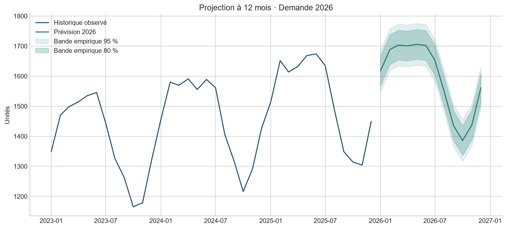
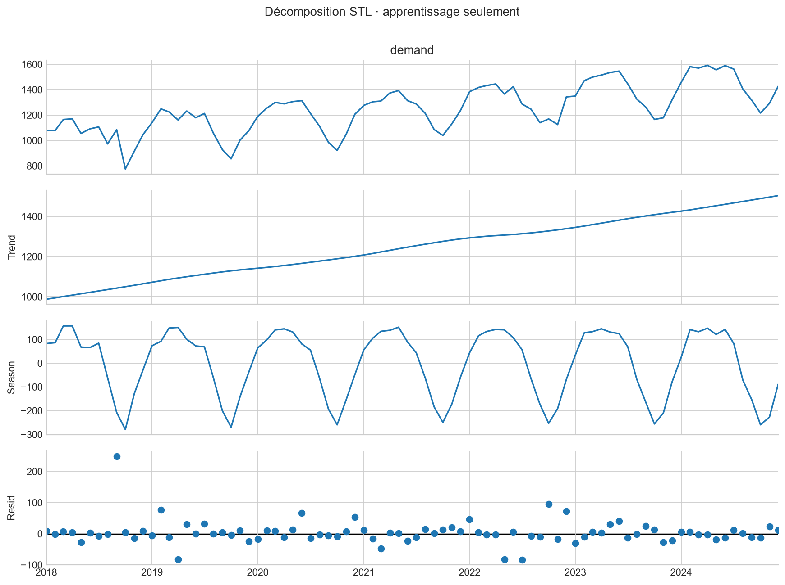
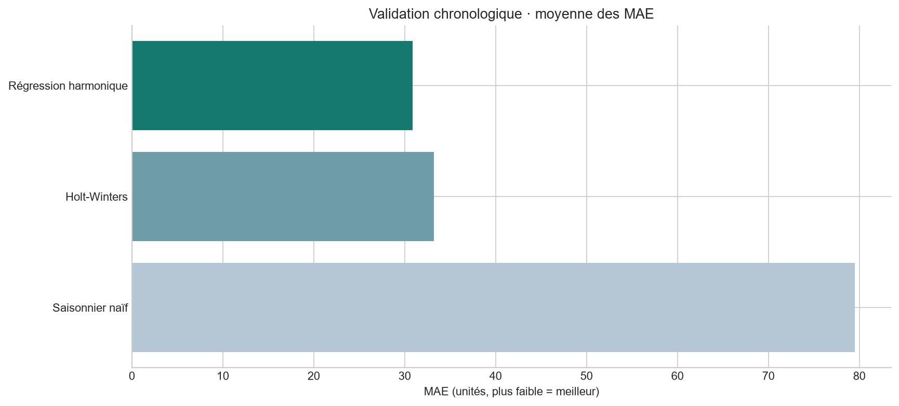
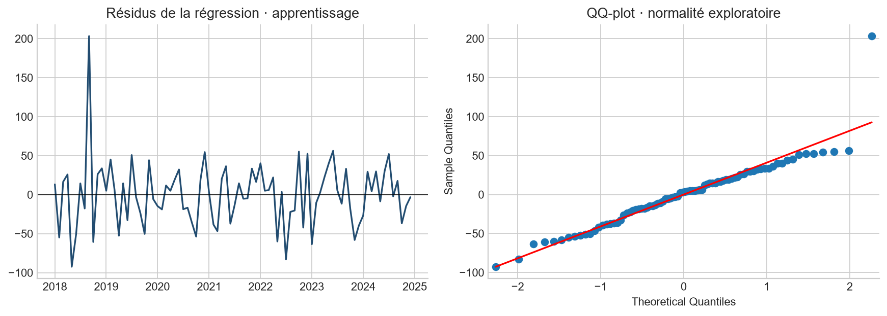
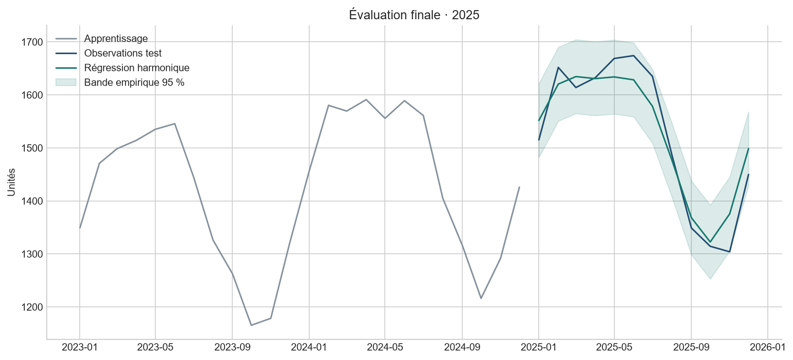

# SAÉ — Analyse Statistique & Prévision de Séries Temporelles

**Samy Houchat · Étudiant en BUT Science des Données (2e année) · IUT Clermont Auvergne (Aurillac)**  
*Parcours : Exploration et Modélisation Statistique (EMS)*  

[](src/analysis.py)
[](scripts/analyse.R)

> **Cadre académique :** Projet universitaire mené dans le cadre de la **SAÉ Séries Temporelles** (Situation d'Apprentissage et d'Évaluation) en **2e année de BUT Science des Données**, parcourant les méthodes d'analyse statistique et de prévision.  
> L'étude porte sur la modélisation statistique et la prévision de la **demande mensuelle (2018–2025)** à partir du jeu de données fourni par l'équipe enseignante, avec une double implantation en Python et en R.

---

## 🎯 Enjeux & Problématique Métier

L'objectif de cette étude statistique est d'anticiper la demande mensuelle à un horizon de 12 mois (année 2026) tout en fournissant une quantification rigoureuse de l'incertitude prédictive :
1. **Assainir et fiabiliser la série chronologique** selon des règles d'ingénierie statistique causale (zéro fuite d'information future).
2. **Décomposer la dynamique temporelle** afin d'isoler la tendance lourde, les périodicités saisonnières et les composantes résiduelles.
3. **Mettre en concurrence plusieurs paradigmes de modélisation** (approche naïve saisonnière, régression harmonique paramétrique, lissage exponentiel de Holt-Winters).
4. **Valider les performances selon un protocole chronologique strict** (validation croisée temporelle à fenêtre glissante sans mélange aléatoire).
5. **Diagnostiquer statistiquement les résidus** via des tests d'hypothèses rigoureux (stationnarité, autocorrélation, normalité, matrice HAC).
6. **Quantifier le risque de prévision** au moyen de bandes empiriques d'incertitude (80 % et 95 %) calibrées et vérifiées sur un échantillon de test réel.



---

## 🛠️ Stack Technique : Logiciels & Langages

Ce projet a été conçu selon les standards de la science des données moderne, garantissant une reproductibilité intégrale et une exécution multi-environnements.

| Catégorie | Outils & Technologies | Rôle et Utilisation dans le Projet |
|---|---|---|
| **Langages de programmation** | **Python 3.12+**<br>**R 4.3+** | • **Python** : Pipeline de production automatisé de bout en bout (`src/analysis.py`).<br>• **R base** : Implémentation miroir autonome en `scripts/analyse.R` pour la modélisation statistique, la décomposition, les diagnostics et les prévisions. |
| **Logiciels & IDE** | **RStudio**<br>**VS Code**<br>**JupyterLab** | • **RStudio** : Développement et exécution des scripts statistiques R, graphiques de décomposition `stl`.<br>• **VS Code** : Développement Python et structure de code modulaire.<br>• **JupyterLab** : Exploration interactive et documentation analytique. |
| **Bibliothèques Python** | `pandas`, `numpy`<br>`scipy`<br>`statsmodels`<br>`matplotlib` | • `pandas` & `numpy` : Ingestion, contrôle d'intégrité, indexation temporelle mensuelle (`MS`), calculs de série chronologique.<br>• `scipy` : diagnostics et statistiques avancées.<br>• `statsmodels` : modèles, ADF, HAC, test Ljung-Box, etc.<br>• `matplotlib` : génération des figures de synthèse. |
| **Packages R (Base)** | `stats`, `graphics`<br>`utils` | • Fonctions de modélisation : `lm()`, `HoltWinters()`, `stl()`.<br>• Fonctions de diagnostic : `shapiro.test()`, `Box.test()`, `anova()`, etc. |

---

## 🔬 Méthodes Statistiques & Modélisations

Le projet mobilise un ensemble complet de méthodes d'**Exploration et Modélisation Statistique (EMS)** :

```mermaid
flowchart TD
    A[Données Brutes 97 obs] --> B[Audit Qualité & Imputation Causale]
    B --> C[Décomposition STL & Lissage Mobile]
    C --> D[Modélisation Concurrentielle]
    D --> E1[Baseline Saisonnière Naïve]
    D --> E2[Régression Harmonique Fourier]
    D --> E3[Lissage Holt-Winters Additif]
    E1 & E2 & E3 --> F[Validation Croisée Temporelle Rolling-Origin 2022-2024]
    F --> G[Sélection du Modèle Optimal MAE]
    G --> H[Diagnostics Statistiques & Covariance HAC Newey-West]
    H --> I[Évaluation Impartiale sur Jeu de Test 2025]
    I --> J[Prévisions 2026 & Bandes d Incertitude 80% / 95%]
```



### 1. Préparation & Ingestion Causale des Données
- **Audit d'intégrité** : Détection des doublons temporels, contrôle des formats de date (début de mois `MS`), repérage des valeurs négatives impossibles dans un contexte de demande.
- **Agrégation** : Médiane par date pour neutraliser l'impact des doublons sans introduire de biais de moyenne.
- **Imputation strictement causale** : Remplacement des valeurs manquantes par la valeur du même mois de l'année précédente ($y_{t-12}$), ou à défaut par la médiane du passé disponible ($y_{1..t-1}$).
- **Isolation des imputations** : Marquage booléen strict (`imputed`) pour exclure impérativement ces points du calcul des scores d'erreur en validation.

### 2. Analyse Exploratoire & Décomposition des Séries Chronologiques
- **Lissage par moyenne mobile d'ordre 12** : Élimination des variations saisonnières intra-annuelles pour dégager visuellement la tendance fondamentale.
- **Décomposition STL robuste (Loess)** :
  $$y_t = T_t + S_t + R_t$$
  Décomposition en composante de tendance ($T_t$), composante saisonnière périodique ($S_t$) et résidus ($R_t$) calculée uniquement sur la période d'apprentissage 2018–2024.

### 3. Modèles Prédictifs Comparés
1. **Référence saisonnière naïve (Baseline)** :
   $$\hat{y}_{T+h} = y_{T+h-12}$$
   Reconduction à l'identique de l'année précédente. Tout modèle statistique élaboré doit impérativement battre cette référence.
2. **Régression harmonique paramétrique (Séries de Fourier)** :
   $$y_t = \beta_0 + \beta_1 t + \sum_{k=1}^{2} \left[ \alpha_k \sin\left(\frac{2\pi k t}{12}\right) + \gamma_k \cos\left(\frac{2\pi k t}{12}\right) \right] + \varepsilon_t$$
   Modélisation conjointe d'une tendance linéaire et de deux harmoniques périodiques (annuelle $k=1$, semestrielle $k=2$).
3. **Lissage exponentiel de Holt-Winters (Formulation Additive)** :
   $$\hat{y}_{t+h|t} = \ell_t + h b_t + s_{t+h-m(k+1)}$$
   Estimation adaptative du niveau $\ell_t$, de la pente $b_t$ et des coefficients saisonniers $s_t$ avec une périodicité $m=12$.

### 4. Protocole d'Évaluation & Validation Croisée Temporelle
- **Rolling-Origin Cross-Validation** : 3 fenêtres chronologiques successives à horizon fixe $h=12$ mois :
  - *Fenêtre 1* : Train 2018–2021 (48 mois) $\rightarrow$ Validation 2022 (12 mois)
  - *Fenêtre 2* : Train 2018–2022 (60 mois) $\rightarrow$ Validation 2023 (12 mois)
  - *Fenêtre 3* : Train 2018–2023 (72 mois) $\rightarrow$ Validation 2024 (12 mois)
- **Sanctuarisation du jeu de test final** : L'année 2025 (mois 85 à 96) est rigoureusement tenue à l'écart de la sélection des modèles.
- **Métrique de décision principale** : Moyenne non pondérée de la **MAE** sur les trois fenêtres de validation.

### 5. Inférence Statistique & Tests d'Hypothèses
- **Test de racine unitaire ADF (Augmented Dickey-Fuller)** : Spécification avec constante et tendance déterministe ($p = 1.35 \times 10^{-13}$ : rejet de l'hypothèse de non-stationnarité stochastique).
- **Test conjoint de Wald sur la saisonnalité** : Test de nullité simultanée des coefficients harmoniques $\alpha_1, \gamma_1, \alpha_2, \gamma_2$ ($p = 2.47 \times 10^{-307}$ : saisonnalité haute et structurée).
- **Correction HAC de Newey-West** : Matrice de variance-covariance robuste à l'autocorrélation (12 retards) et à l'hétéroscédasticité conditionnelle.
- **Test de Ljung-Box sur résidus** : Test d'absence d'autocorrélation résiduelle globale sur 12 retards ($p = 0.232$ : pas de dépendance résiduelle significative au seuil de 5 %).
- **Test de Shapiro-Wilk** : Diagnostic de normalité des résidus ($p = 3.43 \times 10^{-5}$ : rejet de la normalité, justifiant le recours à des intervalles empiriques non paramétriques).

### 6. Métriques de Performance & Quantification d'Incertitude
- **MAE** (*Mean Absolute Error*) & **RMSE** (*Root Mean Squared Error*) : Précision absolue et pénalisation des gros écarts.
- **sMAPE** (*Symmetric Mean Absolute Percentage Error*) : Erreur relative bornée entre 0 et 200 %.
- **MASE** (*Mean Absolute Scaled Error*) : Erreur normalisée par l'écart absolu moyen de la référence saisonnière sur l'apprentissage ($< 1$ atteste d'une modélisation supérieure à la référence).
- **Bandes d'incertitude empiriques à 80 % et 95 %** : Calibrées sur les quantiles supérieurs des erreurs absolues observées en validation croisée, avec vérification du taux de couverture sur le jeu de test.

---

## 📈 Démarche Détaillée Étape par Étape

### Étape 1 : Audit qualité, assainissement et imputation causale
- Examen des 97 lignes brutes : détection d'un doublon de date, d'une valeur négative erronée et de trois mois manquants.
- Alignement sur une fréquence mensuelle régulière de 96 mois (2018-01 à 2025-12).
- Imputation strictement rétrospective (valeur à $t-12$) et enregistrement d'un masque booléen d'imputation dans `data/processed/monthly_clean.csv`.

### Étape 2 : Exploration statistique et décomposition
- Lissage de la série par moyenne mobile 12 mois pour observer l'évolution de la tendance de fond (+5.79 unités par mois).
- Décomposition STL robuste avec fenêtre saisonnière périodique mettant en évidence un profil intra-annuel marqué (pic estival récurrent).



### Étape 3 : Spécification des modèles concurrents
- Implémentation modulaire des 3 familles d'algorithmes dans une fonction unique `forecast(y, horizon, model)` sous Python, et `predict_model()` sous R.
- Paramétrage robuste pour éviter tout surapprentissage.

### Étape 4 : Sélection par validation croisée chronologique (2022–2024)
Les modèles sont évalués sur les 3 fenêtres temporelles successives en excluant les observations imputées :

| Modèle | MAE | RMSE | sMAPE (%) | MASE | Résultat de la sélection |
|---|---:|---:|---:|---:|:---:|
| **Régression harmonique** | **30.89** | **36.37** | **2.27 %** | **0.41** | **Retenu (Meilleure performance globale)** |
| Holt-Winters additif | 33.22 | 40.93 | 2.46 % | 0.44 | Écarté (légèrement moins précis) |
| Saisonnier naïf (baseline) | 79.52 | 89.64 | 5.89 % | 1.04 | Référence dépassée de 61 % |



### Étape 5 : Diagnostics d'adéquation et inférence statistique
- Analyse des résidus de la régression harmonique sur l'ensemble d'apprentissage (84 mois).
- Vérification que la régression capture l'intégralité de la structure temporelle : le test de Ljung-Box ($p = 0.232$) confirme l'absence de résidu d'autocorrélation à 12 mois.
- La non-normalité constatée par le test de Shapiro-Wilk confirme la pertinence d'adopter des **intervalles de prévision non paramétriques (quantiles empiriques)** plutôt qu'une approximation gaussienne.



### Étape 6 : Évaluation finale sur l'année de test 2025 (Isolée)
Le modèle retenu est entraîné sur 2018–2024 (84 mois) et projeté sur l'année 2025 (12 mois réels, sans aucune imputation) :
- **MAE Test :** 32.07 unités (très stable par rapport aux 30.89 obtenus en validation).
- **RMSE Test :** 37.93 unités.
- **sMAPE Test :** 2.12 %.
- **MASE Test :** 0.42 (l'erreur est réduite de 58 % par rapport à la persistance saisonnière de base).
- **Couverture réelle des bandes d'incertitude :**
  - Bande 80 % : **83.3 %** des points observés s'y trouvent (10/12 mois).
  - Bande 95 % : **91.7 %** des points observés s'y trouvent (11/12 mois).



### Étape 7 : Prévisions opérationnelles pour l'année 2026
- Réentraînement du modèle retenu sur la totalité des données historiques disponibles (96 mois de 2018 à 2025).
- Génération des prévisions mensuelles pour l'exercice 2026 complétées par leurs intervalles de confiance empiriques à 80 % et 95 % (`reports/tables/future_forecast.csv`).

---

## 📁 Architecture du Répertoire

```text
├── data/
│   ├── raw/monthly_demand.csv       # Données brutes fournies (97 enregistrements)
│   └── processed/monthly_clean.csv  # Série chronologique assainie avec flag d'imputation
├── docs/
│   ├── DATA_DICTIONARY.md           # Dictionnaire des variables et règles de nettoyage
│   ├── METHODOLOGY.md               # Protocole statistique détaillé et formulations
│   └── VERIFICATION.md              # Procédure de validation de la livraison
├── notebooks/
│   └── 01_analysis.ipynb            # Notebook interactif documenté (Jupyter)
├── reports/
│   ├── figures/                     # 6 visualisations HD générées automatiquement
│   ├── r/                           # Sorties de l'implémentation R (scores, tests, décomposition)
│   ├── tables/                      # Données tabulées (CSV/JSON), métriques et prévisions 2026
│   └── results.md                   # Rapport de synthèse généré par le pipeline
├── scripts/
│   └── analyse.R                    # Implémentation statistique autonome en R de base (RStudio)
├── src/
│   ├── analysis.py                  # Pipeline complet de production Python
│   └── generate_data.py             # Générateur de données synthétiques pour tests unitaires
├── README.md                        # Documentation de référence du projet
└── CV_Samy_Houchat.pdf              # CV associé au projet
```

---

## 💻 Instructions d'Exécution & Reproductibilité

### Option 1 : Environnement R (RStudio / Terminal)

Le script R fonctionne entièrement en **R de base** sans installation de packages CRAN :
```bash
# Depuis la racine du projet :
Rscript scripts/analyse.R
```
Sous **RStudio** : ouvrir le projet, définir le répertoire racine comme dossier de travail (`setwd`), puis exécuter `source("scripts/analyse.R")`. Les résultats et le graphique de décomposition sont générés automatiquement dans le dossier `reports/`.

### Option 2 : Environnement Python

Le pipeline Python est également exécutable directement depuis la racine du projet :
```bash
python -m src.analysis
```

---

## 👤 Informations & Contact

**Samy Houchat**  
Étudiant en 2e année de BUT Science des Données  
*Parcours : Exploration et Modélisation Statistique (EMS)*  
IUT Clermont Auvergne — Campus d'Aurillac  

- **GitHub :** [github.com/HouchatSamy](https://github.com/HouchatSamy)  
- **LinkedIn :** [linkedin.com/in/samyhouchat](https://www.linkedin.com/in/samyhouchat)  
- **Portfolio :** [hctsamyuct.github.io](https://hctsamyuct.github.io)

